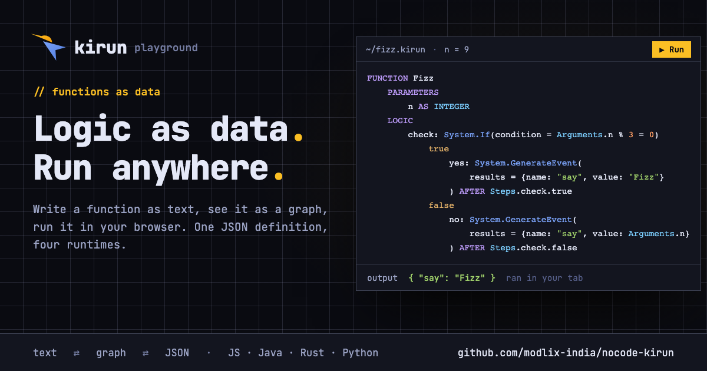

<p align="center">
  <a href="https://kirun.modlix.com">
    <picture>
      <source media="(prefers-color-scheme: dark)" srcset=".github/assets/logo-dark.png">
      
    </picture>
  </a>
</p>

<h3 align="center">Logic as data. Run anywhere.</h3>

<p align="center">
  Write a function as text, see it as a graph, run it in your browser.<br>
  One JSON definition, four runtimes: JavaScript, Java, Rust and Python.
</p>

<p align="center">
  <a href="https://kirun.modlix.com/playground"><strong>Playground</strong></a> ·
  <a href="https://kirun.modlix.com/docs">Docs</a> ·
  <a href="https://kirun.modlix.com/examples">Examples</a> ·
  <a href="https://kirun.modlix.com/learn">Learn</a> ·
  <a href="https://kirun.modlix.com/functions">Functions</a>
</p>

<p align="center">
  <a href="https://kirun.modlix.com/playground"></a>
  <a href="https://www.npmjs.com/package/@fincity/kirun-js"></a>
  <a href="https://central.sonatype.com/artifact/com.fincity.nocode/kirun-java"></a>
  <a href="https://crates.io/crates/kirun"></a>
  <a href="https://pypi.org/project/kirun-py/"></a>
  <a href="https://www.npmjs.com/package/@fincity/kirun-ui"></a>
  <a href="LICENSE"></a>
</p>

<p align="center">
  <a href="https://kirun.modlix.com/playground">
    <picture>
      <source media="(prefers-color-scheme: light)" srcset=".github/assets/social-card-light.png">
      
    </picture>
  </a>
</p>

---

## What is KIRun?

**KIRun** (Kinetic Instruction Runtime) runs functions that are stored as data. A function is a JSON
document: its parameters, its events and a graph of steps, where each step calls another function.
Because it is data, you can store it, diff it, generate it, edit it visually and ship it, and the
same definition runs on the server and in the browser with the same results.

> **The best invention after the wheel, for SaaS.** Every SaaS platform struggles with the same
> problem: rewriting business logic for each platform. KIRun solves it at the root. Define your
> logic once as JSON and it runs everywhere with identical behaviour. No rewrites, no sync issues,
> no drift: one source of truth across your entire stack.

KIRun is the execution backbone of the [Modlix](https://modlix.com) no-code platform: Modlix page
events and server functions are KIRun functions.

**See it before you install it:** the [KIRun playground](https://kirun.modlix.com/playground) runs
kirun-js in your tab. Write a function as text, switch to the graph, run it, and read the per-step
trace. No sign-in.

## Key capabilities

|  |  |
| --- | --- |
| **Four runtimes, one definition** | JavaScript/TypeScript, Java (Project Reactor), Rust and Python execute the same JSON. |
| **Text, graph or JSON** | A readable DSL compiles to the JSON and back; the [visual editor](./kirun-ui/) draws the same function as a graph. |
| **Graph execution** | Steps run as soon as what they depend on is ready, so independent steps run in parallel. |
| **Events, not return values** | A function ends by raising events (`output`, `error`, your own), which is how branching works. |
| **Expressions** | Arithmetic, comparison, logical, bitwise, ternary, `??`, paths with indexes and ranges (`Arguments.items[1..3]`). |
| **166 built-in functions** | In 9 namespaces: System, Math, String, Array, Object, Date, Loop, Context and JSON. [Browse them](https://kirun.modlix.com/functions). |
| **Schemas** | Every parameter is validated against a JSON-style schema before a step runs. |
| **Debug traces** | A debug collector records each step's arguments, result, event and time. |
| **Extensible** | Add your own functions and schemas through repositories, in code or as definitions. |

## Install

| Runtime | Package | Install |
| --- | --- | --- |
| JavaScript / TypeScript | [`@fincity/kirun-js`](https://www.npmjs.com/package/@fincity/kirun-js) | `npm install @fincity/kirun-js` |
| Java 21+ | [`com.fincity.nocode:kirun-java`](https://central.sonatype.com/artifact/com.fincity.nocode/kirun-java) | Maven, see below |
| Rust | [`kirun`](https://crates.io/crates/kirun) | `cargo add kirun` |
| Python 3.9+ | [`kirun-py`](https://pypi.org/project/kirun-py/) | `pip install kirun-py` |
| Visual editor (React) | [`@fincity/kirun-ui`](https://www.npmjs.com/package/@fincity/kirun-ui) | `npm install @fincity/kirun-ui` |

```xml
<dependency>
    <groupId>com.fincity.nocode</groupId>
    <artifactId>kirun-java</artifactId>
    <version><!-- latest from the badge above --></version>
</dependency>
```

## Quick start

A function in the KIRun DSL. It takes `n` and raises `output` with `say`: `"Fizz"` when `n` is
divisible by 3, otherwise `n` itself.
[Open it in the playground](https://kirun.modlix.com/playground) to see it as a graph.

```text
FUNCTION Fizz
    PARAMETERS
        n AS INTEGER
    LOGIC
        check: System.If(condition = Arguments.n % 3 = 0)
            true
                yes: System.GenerateEvent(results = {name: "say", value: "Fizz"}) AFTER Steps.check.true
            false
                no: System.GenerateEvent(results = {name: "say", value: Arguments.n}) AFTER Steps.check.false
```

### JavaScript / TypeScript

```typescript
import {
    FunctionDefinition,
    FunctionExecutionParameters,
    KIRunFunctionRepository,
    KIRunSchemaRepository,
    KIRuntime,
} from '@fincity/kirun-js';

const fd = await FunctionDefinition.fromText(fizzText); // or FunctionDefinition.from(json)

const output = await new KIRuntime(fd).execute(
    new FunctionExecutionParameters(new KIRunFunctionRepository(), new KIRunSchemaRepository())
        .setArguments(new Map([['n', 9]])),
);

console.log(output.next()?.getResult()); // Map { 'say' => 'Fizz' }
```

<details>
<summary><strong>Java</strong></summary>

Java reads the JSON form (compile the text with any of the other runtimes, or copy the JSON from
the playground's JSON tab).

```java
Gson gson = new GsonBuilder().registerTypeAdapter(Type.class, new SchemaTypeAdapter()).create();
FunctionDefinition fd = gson.fromJson(fizzJson, FunctionDefinition.class);

new ReactiveKIRuntime(fd)
    .execute(new ReactiveFunctionExecutionParameters(
            new KIRunReactiveFunctionRepository(), new KIRunReactiveSchemaRepository())
        .setArguments(Map.of("n", new JsonPrimitive(9))))
    .map(FunctionOutput::next)
    .subscribe(e -> System.out.println(e.getName() + " " + e.getResult())); // output {say="Fizz"}
```

</details>

<details>
<summary><strong>Rust</strong></summary>

```rust
use std::sync::Arc;
use kirun::function::Function;
use kirun::model::FunctionDefinition;
use kirun::repository::{KIRunFunctionRepository, KIRunSchemaRepository};
use kirun::runtime::{FunctionExecutionParameters, KIRuntime};

let fd = FunctionDefinition::from_text(fizz_text)?;
let mut fep = FunctionExecutionParameters::new(
    Arc::new(KIRunFunctionRepository::new()),
    Arc::new(KIRunSchemaRepository::new()),
)
.set_arguments(kirun::Map::from([("n".to_string(), serde_json::json!(9))]));

let mut output = KIRuntime::new(fd, false)?.execute(&mut fep).await?;
println!("{:?}", output.next().unwrap().get_result()); // {"say": String("Fizz")}
```

</details>

<details>
<summary><strong>Python</strong></summary>

```python
from kirun_py.dsl.dsl_compiler import DSLCompiler
from kirun_py.model.function_definition import FunctionDefinition
from kirun_py.runtime.ki_runtime import KIRuntime
from kirun_py.runtime.function_execution_parameters import FunctionExecutionParameters
from kirun_py.repository.ki_run_function_repository import KIRunFunctionRepository
from kirun_py.repository.ki_run_schema_repository import KIRunSchemaRepository

fd = FunctionDefinition.from_value(DSLCompiler.compile(fizz_text))
output = await KIRuntime(fd).execute(
    FunctionExecutionParameters(KIRunFunctionRepository(), KIRunSchemaRepository())
        .set_arguments({"n": 9}))
print(output.next().get_result())  # {'say': 'Fizz'}
```

</details>

## Documentation

Read it on the site at **[kirun.modlix.com/docs](https://kirun.modlix.com/docs)**, or here in
[`kirun-docs/`](./kirun-docs/).

| Topic | |
| --- | --- |
| [Architecture](./kirun-docs/architecture.md) | Definitions, steps, the execution plan, stopping and resuming, repositories |
| [Expressions](./kirun-docs/expressions.md) | Syntax, operators and precedence, nested expressions |
| [DSL](./kirun-docs/dsl.md) | The text format and its compiler |
| [Built-in functions](./kirun-docs/functions.md) | Every namespace; the [searchable catalog](https://kirun.modlix.com/functions) has a Try it for each |
| [Schemas and types](./kirun-docs/schemas.md) | Types, validation, composition |
| [JSON definition format](./kirun-docs/json-format.md) | The full format of a function definition |
| [Custom functions](./kirun-docs/custom-functions.md) | Your own functions and repositories in TypeScript and Java |
| [Debugging](./kirun-docs/debugging.md) | The debug collector, event listeners, error tracking |
| [Visual editor](./kirun-docs/visual-editor.md) | Embedding kirun-ui in a React app |

New to KIRun? [Learn](https://kirun.modlix.com/learn) walks through twelve small functions you can
run, and [Examples](https://kirun.modlix.com/examples) has more.

## Repository

| Module | What it is | Package |
| --- | --- | --- |
| [kirun-js](./kirun-js/) | JavaScript/TypeScript runtime and DSL compiler | [npm](https://www.npmjs.com/package/@fincity/kirun-js) |
| [kirun-java](./kirun-java/) | Java runtime on Project Reactor | [Maven Central](https://central.sonatype.com/artifact/com.fincity.nocode/kirun-java) |
| [kirun-rust](./kirun-rust/) | Rust runtime and DSL compiler, a port of kirun-js | [crates.io](https://crates.io/crates/kirun) |
| [kirun-py](./kirun-py/) | Python runtime and DSL compiler | [PyPI](https://pypi.org/project/kirun-py/) |
| [kirun-ui](./kirun-ui/) | React visual (graph) and text editor for definitions | [npm](https://www.npmjs.com/package/@fincity/kirun-ui) |
| [kirun-docs](./kirun-docs/) | The documentation | [kirun.modlix.com/docs](https://kirun.modlix.com/docs) |
| [test-data](./test-data/) | Stored definitions used for cross-runtime conformance | |

The runtimes agree on the same definitions; where they differ on an edge case it is written down,
for example in [kirun-rust/DESIGN.md](./kirun-rust/DESIGN.md). The Rust README also has
[benchmarks](./kirun-rust/README.md#performance) of the same workloads on js, java and rust.

## Build and test

```bash
cd kirun-js   && npm install && npm run build && npm test
cd kirun-ui   && npm install && npm run build && npm test
cd kirun-java && ./mvnw clean install
cd kirun-rust && cargo test
cd kirun-py   && pip install -e '.[dev]' && python -m pytest tests -q
```

## License

[MIT](LICENSE)

---

<p align="center">
  <a href="https://kirun.modlix.com"></a><br>
  <a href="https://kirun.modlix.com">kirun.modlix.com</a> · Built by <a href="https://modlix.com">Modlix</a>
</p>
