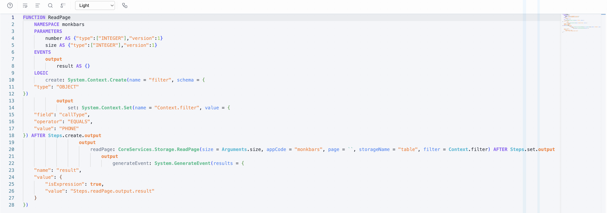

# DSL (Domain-Specific Language)

KIRun includes a human-readable text format (DSL) that compiles to and from the JSON function definition format. The DSL makes function definitions easier to read and write by hand.

> **Status:** The DSL is available in kirun-js. It is a newer feature and supports the full function definition format.

## Overview

Instead of writing JSON:

```json
{
    "name": "AddNumbers",
    "namespace": "MyApp",
    "parameters": {
        "a": { "parameterName": "a", "schema": { "type": ["INTEGER"] } },
        "b": { "parameterName": "b", "schema": { "type": ["INTEGER"] } }
    },
    "events": { "output": { "name": "output", "parameters": { "result": { "type": ["INTEGER"] } } } },
    "steps": { ... }
}
```

You can write DSL:

```
FUNCTION AddNumbers
    NAMESPACE MyApp
    PARAMETERS
        a AS {"type":["INTEGER"]}
        b AS {"type":["INTEGER"]}
    EVENTS
        output
            result AS {"type":["INTEGER"]}
    LOGIC
        add: System.Math.Add(undefined = Arguments.a, undefined = Arguments.b)
        event: System.GenerateEvent(eventName = "output", results = {name: "result", value: Steps.add.output.value})
```

## DSL Compiler API

### Compile (Text to JSON)

```typescript
import { DSLCompiler } from '@fincity/kirun-js';

const json = DSLCompiler.compile(dslText);
// json is a FunctionDefinition-compatible object
```

### Decompile (JSON to Text)

```typescript
const text = await DSLCompiler.decompile(functionDefinitionJson);
```

### Validate

```typescript
const result = DSLCompiler.validate(dslText);
if (!result.valid) {
    console.log(result.errors);
    // [{ message: "...", line: 5, column: 10 }]
}
```

### Format

```typescript
const formatted = await DSLCompiler.format(dslText);
```

### FunctionDefinition Integration

```typescript
import { FunctionDefinition } from '@fincity/kirun-js';

// Parse from DSL
const fd = await FunctionDefinition.fromText(dslText);

// Convert to DSL
const text = await fd.toText();
```

## Syntax Reference

### Function Declaration

The function name and namespace are declared on separate lines:

```
FUNCTION <name>
    NAMESPACE <namespace>
```

Example:

```
FUNCTION ReadPage
    NAMESPACE monkbars
```

### Parameters

Parameters are declared with the `AS` keyword followed by a JSON schema literal:

```
PARAMETERS
    <name> AS <jsonSchema>
```

Examples:

```
PARAMETERS
    a AS {"type":["INTEGER"]}
    b AS {"type":["INTEGER"]}
    name AS {"type":["STRING"]}
    number AS {"type":["INTEGER"],"version":1}
    size AS {"type":["INTEGER"],"version":1}
```

The schema is an inline JSON object matching the KIRun schema format. The `type` field is always an array of type strings.

### Events

Events define output channels with named parameters and their schemas:

```
EVENTS
    output
        <paramName> AS <jsonSchema>
    error
        message AS {"type":["STRING"]}
```

Example:

```
EVENTS
    output
        result AS {"type":["INTEGER"]}
```

Use `{}` for an untyped/any schema:

```
EVENTS
    output
        result AS {}
```

### Logic (Steps)

The `LOGIC` section defines the execution steps. Each step is a function call using colon syntax:

```
LOGIC
    <stepName>: <namespace>.<functionName>(<parameters>)
```

### Step Parameters

Parameters are passed with `=` for assignment:

```
    add: System.Math.Add(undefined = Arguments.a, undefined = Arguments.b)
```

- Parameters use `paramName = value` syntax
- Multiple parameters are comma-separated
- Use `undefined` as the parameter name for unnamed/default parameters
- Values can be expressions (`Arguments.x`, `Steps.step.output.value`), literals (`"string"`, `42`), or JSON objects
- Backticks `` ` ` `` can be used for empty or template values: `` page = ` ` ``

### Dependencies

A step runs after the steps it depends on. Dependencies come from two places only:

- `AFTER Steps.<step>.<event>` on the step, for example `AFTER Steps.create.output`
- `Steps.<step>.<event>` references in the step's argument values

Indentation never creates a dependency. A step written inside another step's block
without an `AFTER` or a reference does not wait for that block.

```
    set: System.Context.Set(name = "Context.filter", value = {field: "callType"}) AFTER Steps.create.output
```

### Event Blocks

The decompiler lays steps out by their dependencies:

- A step that follows another step's `output` is written at the same level, right
  after it, so a sequence reads top to bottom.
- A step that follows any other event (`true`, `false`, `iteration`, `error`, or a
  function's own events) is indented under that event's block name.

```
    auth: System.If(condition = Context.loggedIn = true)
        true
            load: Test.load() AFTER Steps.auth.true
                error
                    loadE: System.GenerateEvent(eventName = "error") AFTER Steps.load.error
            show: Test.show(data = Steps.load.output.value)
        false
            authE: System.GenerateEvent(eventName = "error") AFTER Steps.auth.false
```

Here `show` follows `load`'s output, so it sits next to `load` inside the `true` block.

### Long Calls

A call can be split over lines, one argument per line. The decompiler does this when
the step's line would be longer than 120 characters:

```
    readPage: CoreServices.Storage.ReadPage(
        size = Arguments.size,
        storageName = "table",
        filter = Context.filter
    ) AFTER Steps.set.output
```

### Complex Values (JSON Objects)

Pass JSON objects and arrays directly as parameter values. Keys that are plain names
need no quotes:

```
    create: System.Context.Create(name = "filter", schema = {type: "OBJECT"})
```

Inside an object or array, a value that is not a literal is an expression, and
compiles to `{"isExpression": true, "value": "<expression>"}`. Put an expression in
backticks when it starts with a literal or contains a top-level comma:

```
    event: System.GenerateEvent(results = {name: "result", value: Steps.readPage.output.result})
    total: System.GenerateEvent(results = {name: "label", value: `'Total: ' + Steps.sum.output.value`})
```

Only `System.GenerateEvent` evaluates that object, in the `value` of each `results`
entry. Anywhere else the runtime passes `{"isExpression": true, ...}` through as plain
data: `dataObject = {title: Page.t}` stores the marker, not the title. Build such
objects with `System.Make` (`{{ }}` placeholders) or `SetStore` instead. The
decompiler therefore writes the bare form only in event results, and spells the
marker out everywhere else: `{title: {isExpression: true, value: "Page.t"}}`.

### Named Values

A large object or array can be written once in a `VALUES` section after `LOGIC`, and
used as `@name`:

```
    LOGIC
        cfg: System.Make(resultShape = @cfg.resultShape) AFTER Steps.xc.output
    VALUES
        @cfg.resultShape = {
            unsorted: [{property: "id", direction: "ASC"}],
            rels: [
                {field: "taskId", storage: "task", spec: "task"},
                {field: "noteId", storage: "note", spec: "note"}
            ]
        }
```

Each `@name` compiles to its own copy of the value, exactly as if it were written
inline. The decompiler moves any object or array longer than 100 characters on one
line into `VALUES`, naming it `<step>.<parameter>` (with `.1`, `.2`, ... for a
parameter given several values).

Names are not stored in the function definition. Any name works when writing, but
reformatting or reloading the text renames each value to `<step>.<parameter>`, and a
value used by several steps comes back as one entry per step.

## Complete Examples

### Example 1: Add Two Numbers

```
FUNCTION AddNumbers
    NAMESPACE MyApp
    PARAMETERS
        a AS {"type":["INTEGER"]}
        b AS {"type":["INTEGER"]}
    EVENTS
        output
            result AS {"type":["INTEGER"]}
    LOGIC
        add: System.Math.Add(undefined = Arguments.a, undefined = Arguments.b)
        event: System.GenerateEvent(eventName = "output", results = {name: "result", value: Steps.add.output.value})
```

### Example 2: Read Page with Context and Filtering

```
FUNCTION ReadPage
    NAMESPACE monkbars
    PARAMETERS
        number AS {"type":["INTEGER"],"version":1}
        size AS {"type":["INTEGER"],"version":1}
    EVENTS
        output
            result AS {}
    LOGIC
        create: System.Context.Create(name = "filter", schema = {type: "OBJECT"})
        set: System.Context.Set(
            name = "Context.filter",
            value = {field: "callType", operator: "EQUALS", value: "PHONE"}
        ) AFTER Steps.create.output
        readPage: CoreServices.Storage.ReadPage(
            size = Arguments.size,
            appCode = "monkbars",
            page = ``,
            storageName = "table",
            filter = Context.filter
        ) AFTER Steps.set.output
        generateEvent: System.GenerateEvent(results = {name: "result", value: Steps.readPage.output.result})
```

This example demonstrates:
- **Context creation** - Creating a context variable with a schema
- **Context setting** - Setting a value on the context variable
- **A sequence** - Each step follows the previous one's `output`, so all four sit at one level
- **AFTER declarations** - Explicit dependency ordering
- **Long calls** - `set` and `readPage` take one argument per line
- **Backtick values** - Empty value for `page` parameter using `` ` ` ``
- **Expressions in results** - `value: Steps.readPage.output.result` inside the `results` object

## Key Syntax Rules

| Element | Syntax | Example |
|---------|--------|---------|
| Function name | `FUNCTION <name>` | `FUNCTION ReadPage` |
| Namespace | `NAMESPACE <ns>` (indented) | `NAMESPACE monkbars` |
| Parameter | `<name> AS <jsonSchema>` | `size AS {"type":["INTEGER"]}` |
| Event param | `<name> AS <jsonSchema>` | `result AS {}` |
| Step | `<name>: <ns>.<func>(<params>)` | `add: System.Math.Add(...)` |
| Param binding | `<param> = <value>` | `name = "filter"` |
| Event block | Indented block name | `true` (indented under step) |
| Dependency | `AFTER Steps.<step>.<event>` | `AFTER Steps.create.output` |
| JSON value | Inline JSON object | `schema = {type: "OBJECT"}` |
| Empty value | Backticks | `` page = ` ` `` |
| Expression in JSON | Bare, or in backticks | `{name: "result", value: Steps.add.output.value}` |
| Named value | `@<name>`, defined under `VALUES` | `resultShape = @cfg.resultShape` |

## Monaco Editor Integration

KIRun includes a Monaco Editor integration for DSL syntax highlighting and auto-completion:



*The Monaco-based DSL editor with syntax highlighting, showing the ReadPage function from Example 2.*

```typescript
import { DSLFunctionProvider } from '@fincity/kirun-js';
```

The `DSLFunctionProvider` provides:

- Language definition for syntax highlighting
- Completion providers for function names, parameters, and types
- Hover information for built-in functions

## Compilation Pipeline

The DSL compiler follows a standard three-stage pipeline:

```
DSL Text
    │
    ▼
┌──────────┐
│  Lexer   │ ── Tokenizes text into DSL tokens
└────┬─────┘
     │
     ▼
┌──────────┐
│  Parser  │ ── Builds AST (Abstract Syntax Tree)
└────┬─────┘
     │
     ▼
┌──────────────┐
│  Transformer │ ── Converts AST to FunctionDefinition JSON
└──────────────┘
```

### AST Node Types

| Node                  | Purpose                       |
| --------------------- | ----------------------------- |
| `FunctionDefNode`   | Top-level function definition |
| `ParameterDeclNode` | Parameter declaration         |
| `EventDeclNode`     | Event declaration             |
| `StatementNode`     | Function call step            |
| `ArgumentNode`      | Step argument                 |
| `SchemaNode`        | Type definition               |
| `SchemaLiteralNode` | Inline JSON schema            |
| `ExpressionNode`    | Expression value              |
| `ComplexValueNode`  | Complex value (object/array)  |

### Decompilation

The reverse process (JSON to Text) is handled by `JSONToTextTransformer`:

```typescript
import { JSONToTextTransformer } from '@fincity/kirun-js';

const transformer = new JSONToTextTransformer();
const text = await transformer.transform(functionDefinitionJson);
```
